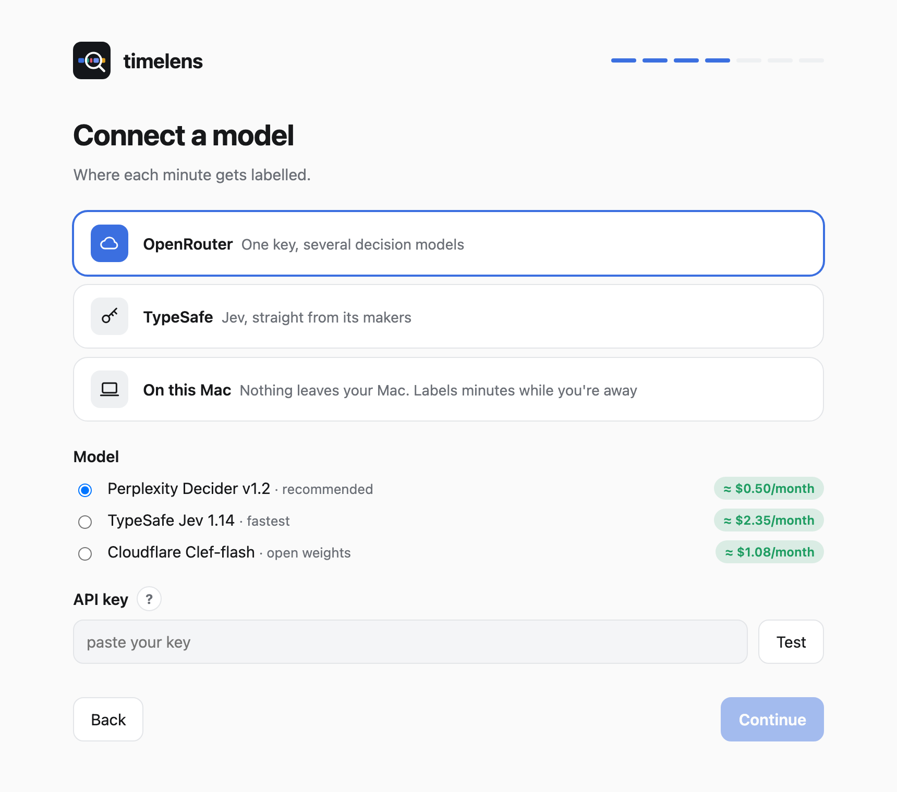
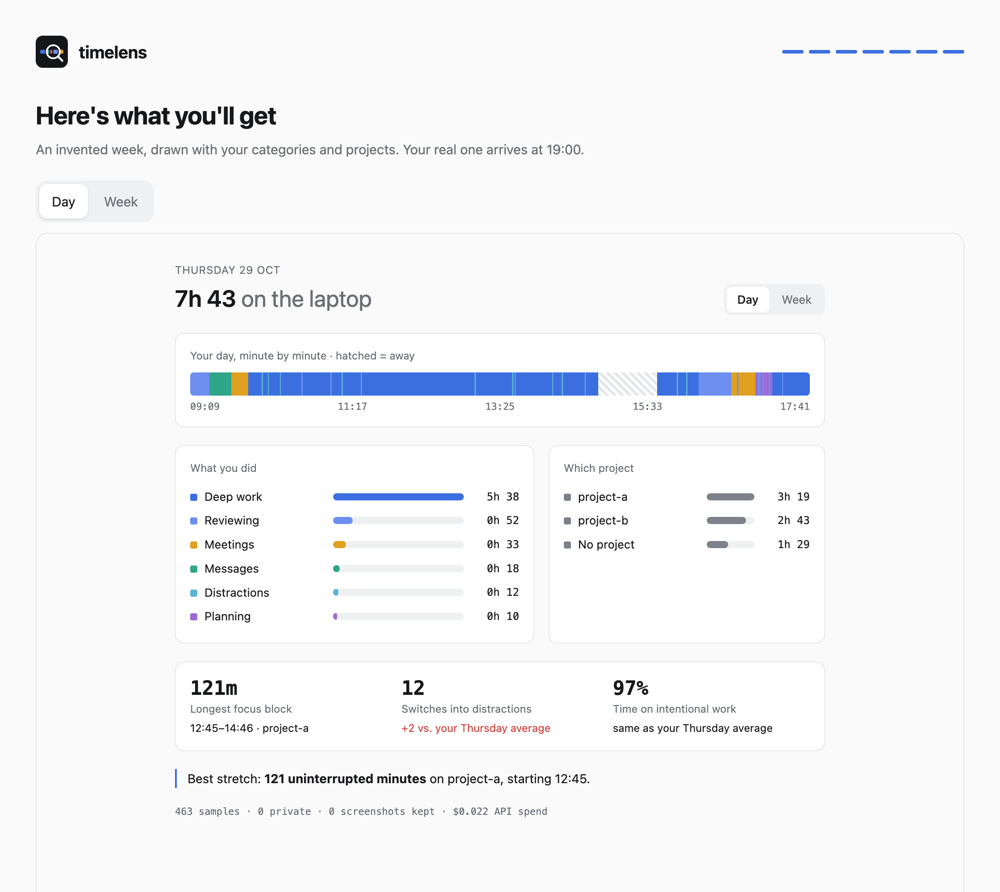
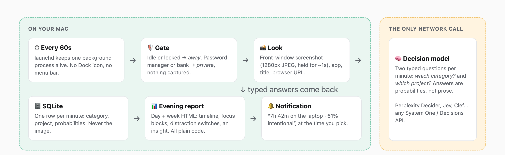

<div align="center">

<picture>
  <source media="(prefers-color-scheme: dark)" srcset="docs/images/hero-dark.png">
  
</picture>

<br>

**Every evening, the honest version of your day.**<br>
A Mac time tracker that looks at your screen once a minute and tells you where the hours went.


[Install](#install) · [What you see](#what-you-see-each-evening) · [What leaves your Mac](#what-leaves-your-mac) · [Goals](#start-from-a-goal) · [Models and cost](#models-and-cost) · [FAQ](#faq)

</div>

---

Most days end with a feeling of having been busy and no clear idea of what with. Timers only work while you remember to press them, and automatic trackers count apps, which stopped meaning much once one chat window or editor started holding your main project, a side project, a quick question and twenty minutes of drifting. To them it's all "Claude" or "Chrome".

timelens looks at what's on the screen instead. Once a minute it shows the front window to a small decision model, which files the minute under categories you chose, with a few sentences of context only you can give ("anything in the `pebble-api` repository is my main product"). At 7 pm a notification gives you the headline, and a report shows the rest.

## What you see each evening

<table>
<tr>
<td width="50%">
<picture>
  <source media="(prefers-color-scheme: dark)" srcset="docs/images/day-dark.png">
  
</picture>
<p align="center"><b>Your day</b>, minute by minute: hours per category and project, your longest stretch of focus, and how often you drifted.</p>
</td>
<td width="50%">
<picture>
  <source media="(prefers-color-scheme: dark)" srcset="docs/images/week-dark.png">
  
</picture>
<p align="center"><b>Your week</b>, seven days stacked. This is where a mid-afternoon slump becomes hard to miss.</p>
</td>
</tr>
</table>

Drift and intentional time are compared with your own average for that weekday, so you can tell a good Thursday from a normal one. The reports are plain HTML files on your disk, and every number in them is computed by ordinary code from the minute log; the model only labels minutes.

## Install

```bash
brew install scandolo/tap/timelens
timelens setup
```

The second command opens a setup page in your browser and takes a few minutes:

1. **Pick a goal.** Each comes with starting categories you can rename, rewrite and extend.
2. **Describe your work** in a few sentences and point it at your project folders, or paste one line into Claude Code, Codex or any other AI agent and let it fill this in from your repositories ([how it works](AGENT_SETUP.md)).
3. **Connect a model** through OpenRouter or TypeSafe, or run one on your own Mac. Each option shows its monthly cost and has a step-by-step guide, and a test request runs before anything starts.
4. **Allow Screen Recording.** The page opens the right settings pane and shows the first minutes being labelled.
5. **See your report** drawn with your own categories before your first real day.

<table>
<tr>
<td width="50%">
<picture>
  <source media="(prefers-color-scheme: dark)" srcset="docs/images/setup-goal-dark.png">
  
</picture>
</td>
<td width="50%">
<picture>
  <source media="(prefers-color-scheme: dark)" srcset="docs/images/setup-categories-dark.png">
  
</picture>
</td>
</tr>
<tr>
<td width="50%">
<picture>
  <source media="(prefers-color-scheme: dark)" srcset="docs/images/setup-model-dark.png">
  
</picture>
</td>
<td width="50%">
<picture>
  <source media="(prefers-color-scheme: dark)" srcset="docs/images/setup-preview-dark.png">
  
</picture>
</td>
</tr>
</table>

After that there's nothing to open or click. timelens runs as one background process with no window or menu bar icon; on the author's MacBook it uses about 0.1% of one CPU core and 22 MB of memory.

```bash
timelens report --open        # today's report and this week's, right now
timelens report 2026-11-03    # any earlier day
timelens setup                # change your goal, categories, model or report time
timelens demo                 # an invented week, no API and no screen access
```

<details><summary>Without Homebrew</summary>

```bash
git clone https://github.com/scandolo/timelens && cd timelens
./install.sh                  # needs uv; opens the same setup page
```
</details>

To pause, run `launchctl bootout gui/$UID/com.timelens.sampler` (`timelens setup` starts it again). To uninstall, also boot out `com.timelens.report`, delete `~/Library/LaunchAgents/com.timelens.*.plist` and `~/Library/Application Support/timelens`, then `brew uninstall timelens`.

## What leaves your Mac

A tool that looks at your screen has to say exactly what happens to what it sees.

| What | What happens to it |
|---|---|
| Screenshot of the front window | Resized to a 1280px JPEG, sent in one HTTPS request, and deleted about a second later. It is never stored. |
| App name, window title, web address | Sent in the same request and kept locally, so past days can be relabelled if you change categories. Email addresses, phone numbers and card or bank numbers in titles are masked first, and addresses lose their query string (searches, tokens, IDs). |
| The model's answer | Kept locally: category, project, probabilities. |
| A password manager or banking site in front | Logged as `private`. Nothing is captured or sent. |
| Idle or locked screen | Logged as `away`. |

The request goes to the provider you chose. The default pins OpenRouter to Perplexity with fallbacks switched off, so your screenshots aren't rerouted to whichever host is cheapest that minute. You can also turn screenshots off and send only app, title and address, which is cheaper and works well for browsers and editors with descriptive titles.

**Or keep everything on your Mac.** With the on-this-Mac option, a local model labels your minutes and nothing goes over the network. Labelling every minute with a 9B model would slow your Mac down while you work, so screenshots wait in a private folder (readable only by you) and get labelled when you've been away for ten minutes or during a window you choose, then deleted. This mode is experimental: it hasn't been tested end to end yet.

timelens is for one person looking at their own time. Reports stay on your disk, and it shouldn't be installed on anyone else's computer.

## Start from a goal

| Goal | For | Categories it starts with |
|---|---|---|
| Show me where my time goes | Anyone curious about their day | work, messages, meetings, learning, admin, downtime |
| Split my time between clients and my own projects | Freelancers and consultants | client work, own projects, messages, meetings, business admin, learning, downtime |
| Protect my deep work | Engineers, writers and designers | deep work, reviewing, messages, meetings, planning, distractions |
| Find out what's distracting me | Anyone who loses afternoons to tabs | work, messages, meetings, social media, video, news, shopping |
| Keep my studying on track | Students | studying, assignments, messages, calls, downtime |

Each category is a plain-English description of what it looks like on screen, plus an optional example of your own. Testing on real screenshots taught one rule above the others: a model can only judge what's visible. Reading documentation to learn and reading it to fix a bug look identical, so keep categories you could tell apart from a screenshot yourself. The presets live in [`presets.toml`](presets.toml), and a good one for a use case we haven't covered makes an excellent first pull request.

## How a minute gets labelled

<picture>
  <source media="(prefers-color-scheme: dark)" srcset="docs/images/how-dark.png">
  
</picture>

timelens uses a **decision model**, sometimes called a System One model. It receives some state and a few multiple-choice questions and returns one answer per question, with a probability for every option and no generated text. That makes it fast (under a second), cheap, and honest about doubt: a minute the model isn't sure about is shown as "unclear" in your report. Here is the request, shortened:

```jsonc
{
  "model": "perplexity/pplx-decider-v1.2",
  "provider": { "order": ["Perplexity"], "allow_fallbacks": false },
  "state": ["App: Cursor", "Window title: pebble-api — server.py", "URL: none", "img-3f2a…"],
  "assets": { "img-3f2a…": { "type": "image", "format": "jpg", "data_base64": "<~150 KB>" } },
  "questions": {
    "activity": { "type": "choice", "instructions": "<your context> … what is the person doing right now?",
                  "criteria": { "deep_work": "Making something that needs concentration… Example: …", "messages": "…", "other": "…" } },
    "project":  { "type": "choice", "instructions": "<your context> … which project is this for?",
                  "criteria": { "pebble-api": "Personal: an API…", "tidepool": "…", "none": "…" } }
  }
}
```

## Models and cost

| Model | Via | ≈ per month* | Notes |
|---|---|---|---|
| **Perplexity Decider v1.2** (default) | OpenRouter | **$0.50** | Open weights, near the top of several public decision benchmarks |
| Cloudflare Clef-flash | OpenRouter | $1.10 | Open weights |
| TypeSafe Jev 1.14 | OpenRouter or TypeSafe | $2.35 | The first System One model, and the fastest in our test (0.55 s) |
| Clef-flash on your Mac | oMLX | Free | Experimental; about 5.5 GB, labels minutes while you're away |

<sub>*Eight hours a day, 22 days a month, one call a minute, with screenshots. On 60 real screenshots the cloud models were equally accurate, on a sample too narrow to separate them, so price and trust in the provider decided the default.</sub>

Any model that speaks the System One / Decisions format works with three lines in `config.toml`. To compare models on your own screen, export `OPENROUTER_API_KEY` and `TYPESAFE_API_KEY` (or put them in a `.env` file in `~/Library/Application Support/timelens/`) and run `timelens eval collect 60 30`, then `timelens eval label` to label an hour of screenshots blind, then `timelens eval compare` for accuracy, calibration, cost and speed.

## FAQ

<details><summary><b>How accurate is it?</b></summary>
Good at anything you could tell from a glance: a call, an inbox, a feed, a repository with a project's name on it. Weaker where the difference lives in your head, such as reading to learn versus reading to get something done. Minutes below the confidence threshold show as "unclear" instead of being guessed. <code>timelens eval</code> gives you a number for your own setup.
</details>

<details><summary><b>Will I notice it on battery?</b></summary>
Unlikely. The process sleeps 59 seconds of every 60 at background priority, and each wake-up is a screenshot, a resize and one ~150 KB upload.
</details>

<details><summary><b>Which browsers does it read addresses from?</b></summary>
Safari, Chrome, Arc, Brave, Edge and Vivaldi. Firefox has no scripting hook for the current address, so there timelens uses the window title and the screenshot.
</details>

<details><summary><b>What about calls where I don't touch the keyboard?</b></summary>
After a minute filed under a category with "meeting" or "call" in its name, up to an hour without input still counts as active. Otherwise five idle minutes count as away.
</details>

<details><summary><b>Why a decision model instead of ChatGPT or Claude?</b></summary>
A chat model writes a sentence you then have to parse, costs more, and gives no probability to decide when a label is too shaky to count. A decision model answers the multiple-choice question directly.
</details>

<details><summary><b>Linux or Windows?</b></summary>
Not yet. The macOS-specific part is about 70 lines (window list, screenshot, idle time, browser address), and a port would be a welcome pull request.
</details>

## Project layout

```
timelens.py       sampler, model request, masking, reports, demo, self-test
onboarding.py     the setup page's local server: presets, config writer, Keychain, launchd
onboarding.html   the setup page
presets.toml      the goals offered during setup
AGENT_SETUP.md    what an AI agent follows to fill in your context
bin/timelens      the command (creates its Python environment on first run)
eval.py           collect real screenshots, label them blind, compare models
docs/             README images and the script that renders them from demo data
```

Your setup and data live in `~/Library/Application Support/timelens/`.

## Contributing

Issues and pull requests are welcome; [CONTRIBUTING.md](CONTRIBUTING.md) has the few rules. Run `timelens selftest` before sending a change, and `./docs/render.sh` if you touch how the reports or the setup page look.

## License

[MIT](LICENSE) © 2026 Federico Scandolara
