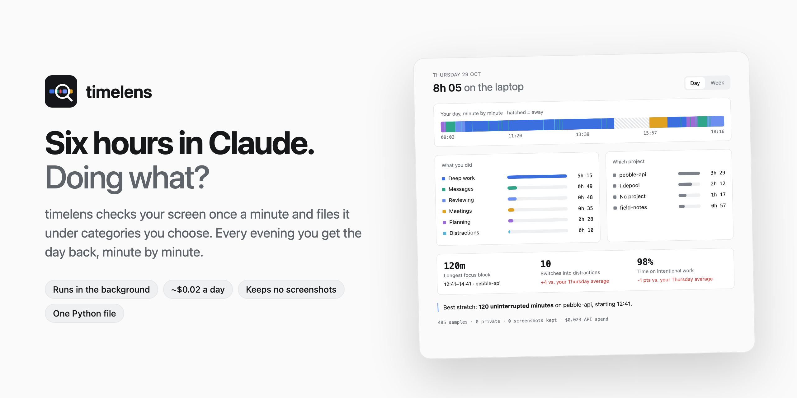
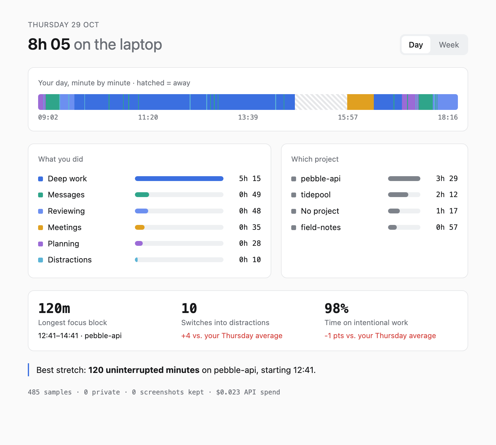
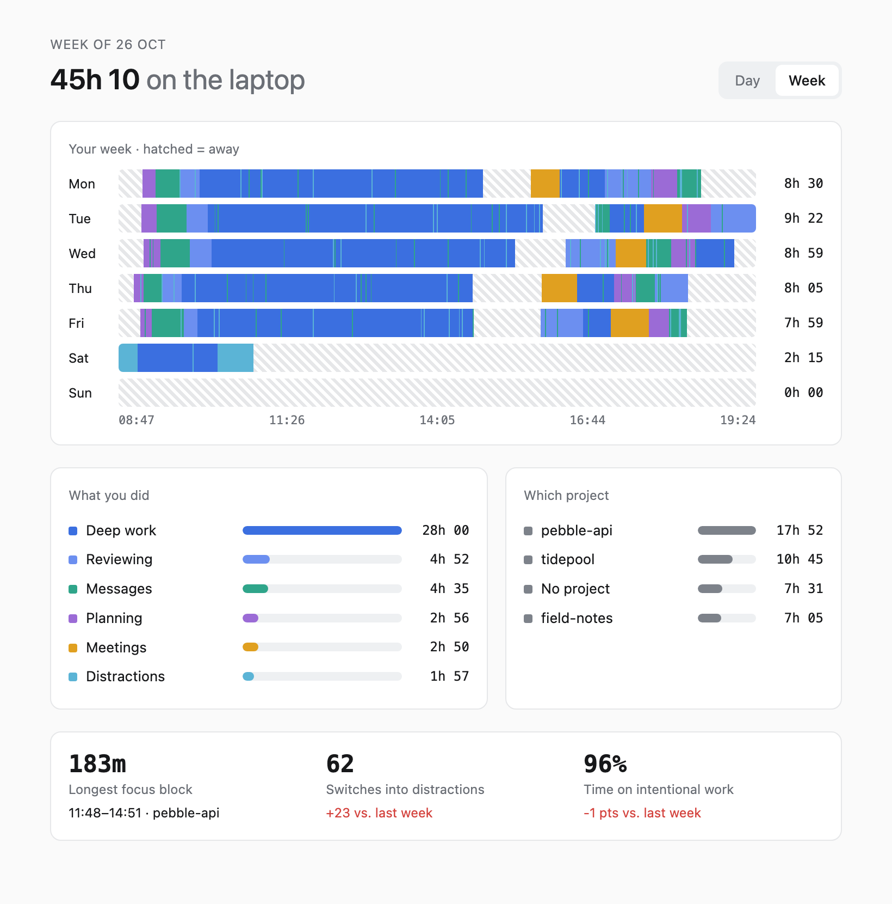
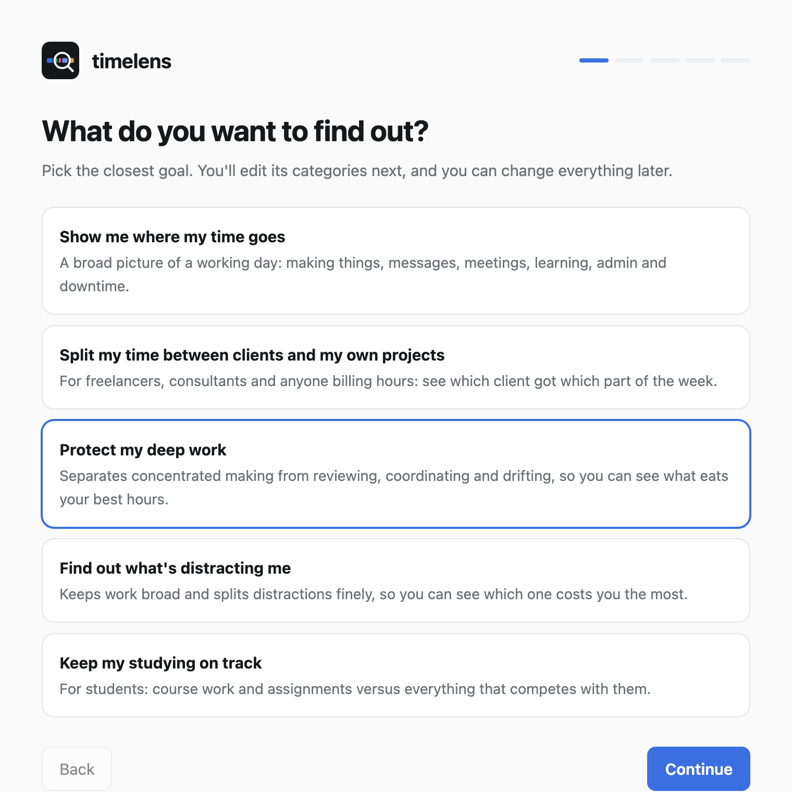
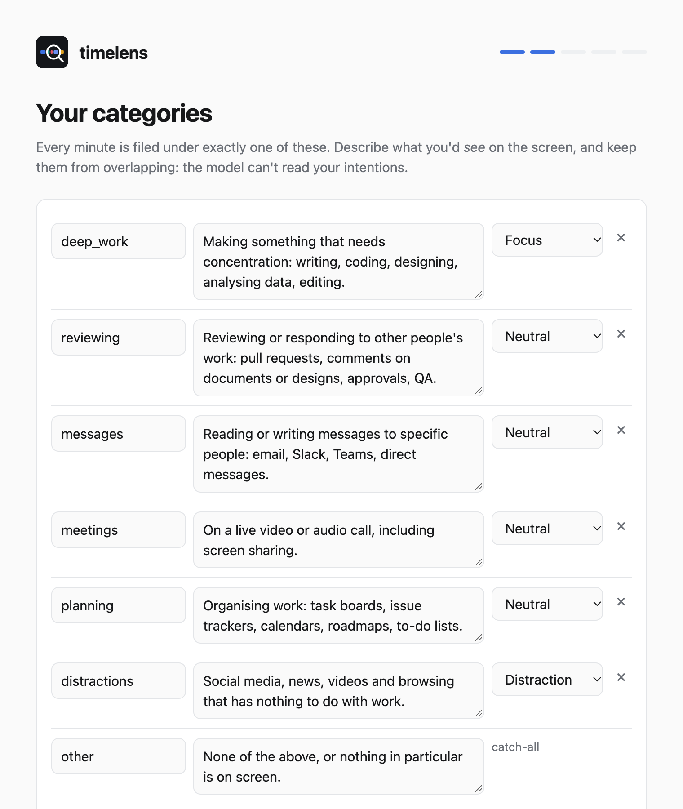

<div align="center">

<picture>
  <source media="(prefers-color-scheme: dark)" srcset="docs/images/hero-dark.png">
  
</picture>

<br>

**A time tracker for your Mac that knows what you did in each app, and for whom.**


[Try the demo](#try-it-in-30-seconds) · [Install](#install) · [What leaves your Mac](#what-leaves-your-mac) · [Categories](#categories) · [Models](#pick-the-model-you-trust) · [FAQ](#faq)

</div>

---

Automatic time trackers count apps and websites. That worked while each app meant one kind of task. Today the same chat window, editor or browser tab holds your main project, a side project, a quick question and twenty minutes of drifting, and the tracker files all of it under one app name.

timelens looks at what's on the screen instead. Once a minute it shows the front window to a small decision model and files that minute under categories you choose, using a few sentences of context only you can give it ("anything in the `pebble-api` repository is my main product"). Every evening you get the day back, minute by minute.

## What you find out

- How your hours split between the projects and kinds of work you care about.
- When your longest stretch of focus happened, and what ended it.
- How often you drifted into distractions, compared with your usual Thursday.
- What share of your laptop time went to things you meant to do.

<table>
<tr>
<td width="50%">
<picture>
  <source media="(prefers-color-scheme: dark)" srcset="docs/images/day-dark.png">
  
</picture>
<p align="center"><b>The day</b>: a minute-by-minute timeline, hours per category and project, your longest focus block and one observation about the day.</p>
</td>
<td width="50%">
<picture>
  <source media="(prefers-color-scheme: dark)" srcset="docs/images/week-dark.png">
  
</picture>
<p align="center"><b>The week</b>: seven days stacked, which is where habits like a mid-afternoon slump become hard to miss.</p>
</td>
</tr>
</table>

A notification arrives at the time you pick with the headline ("7h 42m on the laptop · 61% intentional"). The pages are plain HTML files on your disk. Every number in them is computed by ordinary Python from the minute log; the model labels minutes and nothing else.

## Built to disappear

Once it's installed there's nothing to open, start or click.

- It runs as one launchd background process you never see. On the author's MacBook it uses about 0.1% of one CPU core and 22 MB of RAM.
- Each minute costs around 2,350 tokens. At $0.02 per million, a full working day comes to about two cents.
- It skips minutes when you're idle, the screen is locked, or a password manager or banking site is in front.
- The app is two Python files of about 720 lines in total, so you can read it before you trust it.

## Try it in 30 seconds

The demo renders five weeks of an invented engineer's days with the same report code. It needs [uv](https://docs.astral.sh/uv/), but no API key, and it never touches your screen.

```bash
git clone https://github.com/scandolo/timelens && cd timelens
uv run --python 3.13 timelens.py demo     # prints a folder; open the .html files inside
```

## Install

You need a Mac, [uv](https://docs.astral.sh/uv/) (`brew install uv`) and an API key from [OpenRouter](https://openrouter.ai/settings/keys) or [TypeSafe](https://console.typesafe.ai). Then:

```bash
git clone https://github.com/scandolo/timelens && cd timelens
./install.sh
```

That opens a short setup page in your browser:

1. **Pick a goal.** Each one comes with a starting set of categories: an overview of your day, clients versus your own projects, deep work, distractions, or studying.
2. **Edit the categories.** Rename them, rewrite what each one looks like on screen, and mark which count as focus and which as distraction.
3. **Add context.** A few sentences about what you do, and the folders where your projects live. Each subfolder becomes a project the model can recognise.
4. **Connect a model and test it.** Paste your key and press *Test it*: one text-only request comes back with a real answer before anything runs in the background. The key goes into your macOS Keychain.
5. **Start tracking**, then grant Screen Recording. The page gives you the exact file to allow and shows the first minutes being labelled as they arrive.

<table>
<tr>
<td width="50%">
<picture>
  <source media="(prefers-color-scheme: dark)" srcset="docs/images/setup-goal-dark.png">
  
</picture>
</td>
<td width="50%">
<picture>
  <source media="(prefers-color-scheme: dark)" srcset="docs/images/setup-categories-dark.png">
  
</picture>
</td>
</tr>
</table>

Run `./install.sh` again whenever you want to change your setup; it starts from what you already have. Day to day you'll only need these:

```bash
.venv/bin/python timelens.py report --open        # today's and this week's report, right now
.venv/bin/python timelens.py report 2026-11-03    # any earlier day
.venv/bin/python timelens.py sample --dry-run     # print the exact request it would send, and send nothing
launchctl bootout gui/$UID/com.timelens.sampler   # pause (run ./install.sh again to resume)
```

To uninstall, run the two `launchctl bootout` lines at the top of `install.sh`, then delete `~/Library/LaunchAgents/com.timelens.*.plist` and `~/Library/Application Support/timelens`.

## What leaves your Mac

Here is everything that happens to what timelens sees.

| What | What happens to it |
|---|---|
| Screenshot of the front window | Resized to a 1280px JPEG in a temporary folder, sent in a single HTTPS request, and deleted about a second later. It is never written to the database. |
| App name, window title, browser address | Sent in the same request, and stored locally so you can relabel past days if you change your categories. |
| The model's answer | Stored locally: category, project, probabilities and token count. |
| Minutes with a password manager or banking site in front | Logged as `private`. No screenshot is taken and no request is made. |
| Idle or locked minutes | Logged as `away`. |

The one request per minute goes to the provider you chose during setup. The default pins OpenRouter to Perplexity with fallbacks switched off, so your screenshots can't be rerouted to whichever host is cheapest that minute. Read that provider's data policy before you install, or pick another one.

If you'd rather send no images at all, untick screenshots during setup (or set `screenshots = false`) and timelens works from the app, title and address alone. That's good enough for browsers and editors with descriptive titles, and noticeably worse inside chat apps.

timelens is built for one person looking at their own time. Reports stay on your disk and go to nobody else, and it shouldn't be installed on anyone else's computer.

## Categories

The setup page writes everything to `config.local.toml` (git-ignored), which you can also edit by hand. Each category is a name and a description of what it looks like on screen:

```toml
[categories]
deep_work    = "Making something that needs concentration: writing, coding, designing, analysing data, editing."
reviewing    = "Reviewing or responding to other people's work: pull requests, comments on documents or designs, approvals, QA."
messages     = "Reading or writing messages to specific people: email, Slack, Teams, direct messages."
meetings     = "On a live video or audio call, including screen sharing."
planning     = "Organising work: task boards, issue trackers, calendars, roadmaps, to-do lists."
distractions = "Social media, news, videos and browsing that has nothing to do with work."
other        = "None of the above, or nothing in particular is on screen."

[report]
focus = ["deep_work"]
distractions = ["distractions"]
```

Testing on real screenshots taught three things. A model can only judge what's visible: reading documentation to learn and reading it to fix a bug look identical, so merge categories you couldn't tell apart from a screenshot yourself. Keep categories mutually exclusive, and write the borderline cases into the descriptions. Order matters slightly, because decision models lean toward earlier options.

The goal presets live in [`presets.toml`](presets.toml). A good preset for a use case we haven't covered makes an excellent first pull request.

## Pick the model you trust

Any model that speaks the System One / Decisions format works. The setup page offers two; others take three lines in the config (`api_url`, `model`, `price_per_mtok`).

| Model | Input $/M tokens | Tokens per call* | $ per day* | Median latency* | Notes |
|---|---|---|---|---|---|
| **Perplexity Decider v1.2** (default) | 0.020 | 1,635 | **$0.016** | 1.08 s | Open weights (Apache 2.0), ranks near the top of several public decision benchmarks |
| TypeSafe Jev 1.14 | 0.042 | 3,712 | $0.075 | **0.55 s** | The first System One model, via TypeSafe's own API |
| Cloudflare Clef-flash | 0.038 | 1,867 | $0.034 | 0.84 s | Open weights |
| OpenAI GPT-6 Luna Decisions | 0.100 | 1,752 | $0.084 | 0.82 s | |
| Liquid d1 | 0.020 | 2,067 | $0.020 | 0.88 s | Often disagreed with the others on projects |

<sub>*Measured on 60 real screenshots at 480 calls a day. All five models were equally accurate on that sample, which was too narrow to separate them, so price and trust in the provider decided the default.</sub>

To run the same comparison on your own screen, put your keys in `.env` (see `.env.example`) and run:

```bash
.venv/bin/python eval.py collect 60 30   # one screenshot every 30s for an hour, kept in eval/ (git-ignored)
.venv/bin/python eval.py label           # label them yourself at http://localhost:8765, without seeing any model's answer
.venv/bin/python eval.py compare         # every model on every screenshot: accuracy, calibration, cost and latency
```

## FAQ

<details><summary><b>How accurate is it?</b></summary>
It's good at anything you could tell from a glance at the screen: a call, an inbox, a feed, a repository with a project's name on it. It's weaker where the difference lives in your head, such as reading to learn versus reading to get something done. Minutes below <code>min_confidence</code> show as "unclear", so a guess doesn't pass for a fact. Run <code>eval.py</code> on an hour of your own work to get a number for your setup.
</details>

<details><summary><b>Will I notice it on battery?</b></summary>
Unlikely. The process sleeps 59 seconds of every 60, runs at background priority, and each wake-up is a screenshot, a resize and one ~150 KB upload. Running a vision model locally would use far more energy than that network call.
</details>

<details><summary><b>Which browsers does it read addresses from?</b></summary>
Safari, Chrome, Arc, Brave, Edge and Vivaldi. Firefox has no scripting hook for the current address, so for Firefox timelens relies on the window title and the screenshot.
</details>

<details><summary><b>Does it work with multiple monitors?</b></summary>
Yes. It captures the frontmost window wherever it sits, rather than a whole display.
</details>

<details><summary><b>What about calls where I don't touch the keyboard?</b></summary>
After a minute filed under a category whose name contains "meeting" or "call", up to an hour of idle time still counts as active. Otherwise five idle minutes count as away.
</details>

<details><summary><b>Why a decision model instead of a regular LLM?</b></summary>
A chat model writes a sentence you then have to parse, costs more, and gives you no probability to decide when a label is too shaky to count. A decision model answers the multiple-choice question directly, usually in under a second.
</details>

<details><summary><b>Linux or Windows?</b></summary>
Not yet. The macOS-specific part is about 70 lines (window list, screenshot, idle time, browser address); everything else is portable. A port would be a welcome pull request.
</details>

## Project layout

```
timelens.py       sampler, model request, reports, demo, self-test
onboarding.py     the setup page's local server: presets, config writer, Keychain, launchd
onboarding.html   the setup page itself
presets.toml      the goal presets offered during setup
config.toml       defaults; your own setup goes to config.local.toml
install.sh        creates the Python environment and opens the setup page
eval.py           collect real screenshots, label them blind, compare models
docs/             README images and the script that renders them from demo data
```

Your data lives in `~/Library/Application Support/timelens/` (`log.sqlite`, `reports/`, logs).

## Contributing

Issues and pull requests are welcome; [CONTRIBUTING.md](CONTRIBUTING.md) covers the few rules. Run `uv run --python 3.13 timelens.py selftest` before sending a change, and `./docs/render.sh` if you touch how the reports or the setup page look.

## License

[MIT](LICENSE) © 2026 Federico Scandolara
